<h1 align="center">⚡ spark-bench</h1>

<p align="center">
  <b>Four DGX Sparks · one TP=4 world · every lesson, dated.</b><br>
  Recipes, configs and benchmarks for running frontier MoE models on <b>4× NVIDIA DGX Spark</b> (GB10).
</p>

<p align="center">
  
  
  
</p>

<a id="now-serving"></a>

## 📌 Now serving: DeepSeek V4.1 Flash 1017 on our TensorFold 1.1.2 rebase (2026-10-22)

The Sparks now serve **DeepSeek V4.1 Flash 1017**, DeepSeek's official 1017 checkpoint, as a 2.9-bit EXL3 quant on our
**TensorFold Zig engine** (TP=4 over RoCE), now on our **TensorFold 1.1.2 rebase** — 313 tok/s aggregate at 8 streams,
166 s warm boot, all 15 determinism hashes unchanged from the engine it replaced (details in
[the 1.1.2 entry below](#dsv41-1017-tf112)). Serving the 1017 pack is a **config-only drop-in**: three weight-derived
inputs rebuilt from the 1017 base (the Engram tables, the image-routing bias and the prepared layer folders).

<picture>
  <source media="(prefers-color-scheme: dark)" srcset="docs/images/3d-headline-dark-20261017.png">
  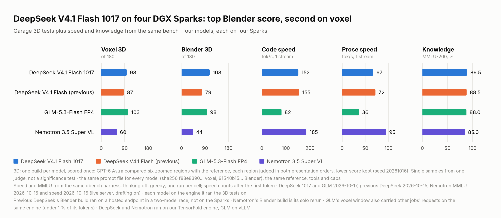
</picture>

**Why it stays:**
- **It matches or beats the previous pack on every quality area.** MMLU-200 89.5 % vs 88.5 % (+9 / −7 items). Math, coding,
  instruction following, JSON, tools, long context and summaries are equal.
- **It has the top Blender 3D score of the four models we tested** (108/180, vs GLM 98, previous DeepSeek 79, Nemotron 44).
  It is second on the voxel test (98, behind GLM's 103 and ahead of the previous DeepSeek's 87).
- **Its cost is speed.** Decode is 2–7 % lower than the previous pack (code 151.8 vs 155.4 tok/s, prose 67.3 vs 72.0, four
  streams 162.4 vs 172.1). Its 3D builds took 1.5–1.6× as long (voxel 26 m 51 s vs 16 m 39 s). Cold prompt reading is
  unchanged (200K tokens in 35.7 s vs 36.8 s).
- **Caveats:** every speed cell and every 3D score is a single sample. The 3D scores come from one judge.

Details: [the 1017 lane](#dsv41-1017) · [the 3D tests](#3d-tests) · [harness effect](#dsv41-1017-harness) ·
[the GLM-5.3-Flash comparison](#glm53-fp4-vllm) · [the previous note: back on DeepSeek, not Nemotron (2026-10-16)](#now-serving-20261016)

---

## 🧭 Lanes

One cluster, one model at a time. Click a lane for its recipe.

| | Lane | Status | Best numbers |
| :-: | --- | --- | --- |
| 🐋 | **[DeepSeek V4.1 Flash 1017 · our TensorFold 1.1.2 rebase (Zig engine)](#dsv41-1017-tf112)** | 🟢 **live** since 2026-10-22 · [why](#dsv41-1017-tf112) | **313 tok/s aggregate with 8 streams** · 212 with 4 · warm boot 166 s · 15/15 determinism hashes unchanged · same pack, **512K context** · single-stream code/prose not yet re-measured on this build |
| 🐋 | [DeepSeek V4.1 Flash 1017 · TensorFold 1.1.0-era engine (Zig)](#dsv41-1017) | 🟡 previous (live 2026-10-17 → 2026-10-22) | 152 code tok/s (162 for 4) · 296 tok/s aggregate with 8 streams · 67 prose · cold 200K prompt 35.7 s · 512K context (passkey at 520K) · MMLU 89.5 % · 3D 98 + 108/180 |
| 🐋 | [DeepSeek V4.1 Flash · TensorFold (Zig engine)](#dsv41-tensorfold) | 🟡 previous (live 2026-10-11 → 2026-10-15 and 2026-10-16 → 2026-10-17) | 129 code tok/s (218 for 4) · 66 prose (138 for 4) · cold 154K prompt 30 s |
| 🐉 | [GLM-5.3-Flash FP4 · vLLM](#glm53-fp4-vllm) | 🔵 compared 2026-10-17, not serving | 82 code tok/s · 37 prose · MMLU 88.0 % · 3D 103 + 98/180 |
| 🟩 | [Nemotron 3.5 Super VL · TensorFold (Zig engine)](#nemotron-tensorfold) | 🟡 previous (live 2026-10-15 → 2026-10-16) · [why not now](#now-serving-20261016) | 185 code tok/s · 95 prose · 16 conversations × 307K tokens · 214–230 tok/s for 16 |
| 🐋 | [DeepSeek V4.1 Flash · SGLang](models/deepseek-v4.1-flash/README.md) | 🟡 rollback | 38 prose / 54–62 code tok/s · 1M context |
| 🐋 | [DeepSeek V4.1 Flash · vLLM](docs/dsv41-vllm-tp4.md) | 🟡 fallback | 71 code tok/s · 109 tok/s for 4 users |
| 🦄 | [Qwen 3.8 Flash Next](models/qwen-3.8-flash-next/README.md) | ⚪ archived | 91 code tok/s · 600 tok/s for 16 users |
| 🐉 | [GLM 5.3 Flash](models/glm-5.3-flash/README.md) | ⚪ archived | 129 tok/s for 4 users · 1M context |
| 🐳 | [DeepSeek V4 Flash](models/deepseek-v4-flash/README.md) | ⚪ archived | 136 tok/s, one user (record) · 182 for 4 |

<sub>tok/s = writing speed. Rulers differ between lanes; each lane page says how its numbers were measured.</sub>

## 🧠 Why this repo exists

This repo is about **four Sparks working as one machine**, and it keeps **every optimization we tried**: what we changed, what it measured, what failed and why, all dated.

That history is the point. When a new model comes out, the next engineer (or the next **AI agent**) should start from the best known config and the known traps, not find them again. Old lanes stay here on purpose: their lessons carry over to new models.

## 🤖 For AI agents

1. **Pick a lane** above. Its page is the recipe: image, flags, setup, rollback.
2. **Read the lane's journal** (`models/<model>/JOURNAL.md`) for every dated change, A/B result and dead end.
3. **Check the evidence.** Raw runs are in `artifacts/` and `results/`, linked from each entry.
4. **Wire the fabric first** ([docs/FABRIC.md](docs/FABRIC.md)), then follow the operator rules in [models/README.md](models/README.md).
5. **Write down what you learn**: a dated journal entry with its numbers, how they were measured, and its config. Never overwrite old evidence.

### Lessons that carry over

- 🔌 **Fix the network first.** One IPv4 address per NCCL port. A leftover address alone cost 30% ([V4](models/deepseek-v4-flash/JOURNAL.md)). Getting RoCE right was worth 2.5× ([GLM](models/glm-5.3-flash/JOURNAL.md)).
- 📏 **Measure decode from the stream:** count usage tokens from the first delta to the last. Wall time includes prompt reading, and chunk counts undercount speculative decoding.
- 🎲 **Boots vary.** Compare A/B/A with a same-night control. `vm.compaction_proactiveness=0` ended a 50/50 slow-boot lottery ([V4.1](models/deepseek-v4.1-flash/JOURNAL.md#dsv41-2026-09-13)).
- 🔥 **Warm up before you trust a number.** JIT kernels and draft acceptance start cold (acceptance went from 2.6 at first boot to 7.95 an hour later). Warm the kernels at boot.
- 🧮 **Unified memory is GPU memory.** Leave headroom (GLM crashed at 0.85 and is stable at 0.80) and drop the page cache before a start.
- 💾 **No bulk disk writes on a serving node.** Engram reads NVMe on every step, so one slow rank stalls all four.
- 🕵️ **Fallbacks are silent.** Check the boot log for the transport you expect (`over RoCE`, not NCCL) after every start. A leftover failure file cost TensorFold 12–19% for two days ([report](artifacts/tensorfold-v41-roce-20261007/REPORT.md)).
- ⏳ **Busy is not wedged.** Check the queue before restarting. A server is alive only if it answers a real 1-token completion.
- ✍️ **Speculative decoding depends on the text.** Code and math run about 2× faster than prose. Always quote task, prompt length and thinking mode.
- 🪶 **Fewer bytes per token, faster decode.** 2.9-bit EXL3 gave 1.7× over FP8 on the same four Sparks.
- 🧩 **Uneven splits hide bugs.** Test the request shapes that stress them, like `top_k` above one rank's vocabulary slice.

---

<a id="dsv41-1017"></a>

## 🐋 DeepSeek V4.1 Flash 1017 · TensorFold (Zig engine) · live 2026-10-17 → 2026-10-22

> Since 2026-10-22 this lane serves on our **TensorFold 1.1.2 rebase** — see [the 1.1.2 entry](#dsv41-1017-tf112) for its numbers. The figures in this section were measured on the earlier engine and are kept as the record.

DeepSeek's official `deepseek-ai/DeepSeek-V4.1-Flash-1017`, as the third-party 2.9 bpw EXL3 quant
`LibertAIDAI/DeepSeek-V4.1-Flash-1017-EXL3-2.9bpw` (rev `afc7aa0a`), on the same engine, image and serving settings as the
[previous DeepSeek lane](#dsv41-tensorfold). Same frozen bench, same harnesses, same scoring.

**A config-only drop-in.** The config, tokenizer and every tensor name and shape are unchanged. The 1017 pack adds 43
`gate.bias_vl` tensors, and its MTP drafter matrices are 6 bpw instead of 4 (the loader reads the width from the weights).
Three weight-derived inputs were rebuilt from the 1017 base checkpoint:
- the **Engram tables** (they changed in 1017);
- the **image-routing bias** (34 of its 43 tensors differ from the old V4.1);
- the **prepared layer folders** (written fresh on the first boot, 405 s).

The engine's prompt renderer matches 1017's own `encoding.py` on every request shape this bench sends.

**Context: 524,288 tokens (512K) a slot, 4 slots, tested with passkeys at 500K and 520K** (since 2026-10-17; before:
420K). The model's own limit is 1,048,576 (yarn ×16). It took a longer `rope.bin` and 11 more AOT Triton variants a
rank, no engine change ([how, for any context](https://github.com/neko-legends/tensorfold-4x-sparks/blob/main/deploy/dsv41-1017/RUN.md#choosing-the-context)).

| Long prompt at 512K (2026-10-17, qbench's passkey filler and scoring, thinking off) | result | cold prompt reading |
| --- | --- | ---: |
| 500,006 tokens | passkey correct | 101 s (~4,950 tok/s) |
| 520,006 tokens | passkey correct | 107 s (~4,880 tok/s) |
| decode after a cached 520,000-token prefix | passkey and a count to 60 correct | 123 tokens in 1.3 s |
| 530,000 tokens (over the limit) | clean HTTP 400, engine stays healthy | 2.3 s |
| `verify.py` gates after the switch | 7/7 | |

| Area | DeepSeek V4.1 Flash **1017** (TensorFold) | DeepSeek V4.1 Flash, uncensored pack (TensorFold) | GLM-5.3-Flash FP4 (vLLM) | DeepSeek V4.1 Flash full precision (Venice, hosted) |
| --- | ---: | ---: | ---: | ---: |
| Knowledge, MMLU-200 | 89.5 % (179/200) | 88.5 % | 88.0 % | 90.0 % |
| Math, GSM8K 0–29 | 100 % | 100 % | 100 % | 100 % |
| Coding, 5 tasks | 80 % | 80 % | 80 % | 80 % |
| Instruction following, 20 | 90 % | 90 % | 90 % | 95 % |
| JSON schema / tools / long context (25K/100K/229K-token prompts) | 100 / 100 / 100 % | 100 / 100 / 100 % | 100 / 100 / 100 % ¹ | 100 / 100 / 100 % |
| Summary: facts kept / stale / invented numbers | 100 / 0 / 0 % | 100 / 0 / 0 % | 100 / 0 / 4.2 % | 100 / 0 / 0 % |
| Vision text, 166 strings | 166/166 | 166/166 | 166/166 | – |
| Vision shapes 30 (a3 + a5) / objects counted 23 | 29/30 / 22/23 | – / 22/23 | 28/30 / 0/23 | – |
| Code / prose, 1 stream (tok/s) | 151.8 / 67.3 | 155.4 / 72.0 | 82.0 / 36.5 | – |
| 4 streams, aggregate (tok/s) | 162.4 | 172.1 | 81.2 | – |
| TTFT, short prompt (code / prose) | 0.17 / 0.19 s | 0.17 / 0.14 s | 0.25 s | – |
| Cold prompt 32K / 131K / 200K tokens | 6.2 / 22.8 / 35.7 s | – / – / 36.8 s | 12.3 / 50.8 / 79.4 s | – |

- ¹ Not like-for-like (review correction): on GLM's run qbench's `/tokenize` call returned nothing, so its passkey
  prompts were not calibrated and measured 26.7K / 106.8K / 243.5K tokens instead of 32K / 131K / 299K.
- Speed is one sample per cell. Earlier rebenches put run-to-run noise at 1–2.5 %, so the −2 to −7 % gap is probably
  real but small. A likely cause is the 1017 pack's drafter, a different, higher-bpw quant (not isolated).
- The GLM column is vLLM, its best engine today ([lane](#glm53-fp4-vllm)). The last column is the old V4.1 at full
  precision on a hosted API, as a compression check: 90.0 % vs 88.5 % for our older 2.9-bit pack, which mixes the
  uncensoring of that pack with the quantization cost. 1017 at 2.9 bits is within 0.5 points of it.
- Vision text reading is exact; text box positions are 8–63 px off (GLM: 1–2 px).

<a id="dsv41-1017-slots"></a>

#### 🧵 Concurrency: 8 slots — 296 tok/s aggregate (2026-10-20)

Four slots were a scheduling choice, not a limit. Serving `TF_DSV41_SLOTS=8` on the **same** pack, **same** rebased
engine and the **same** 512K asset fill needed **no new kernels**: the 8-slot `aot-needs` sweep enumerates exactly the
specialization set the 4-slot fill already had — 166 keys, **0 added, 0 gone**, `compiled: 0, failed: []` on all four
ranks. Boot reports `"max": 8`, four ranks, 0 errors.

Rows per round = live slots. Same 5,284-token prompt on every stream, warm, greedy:

| live slots (rows/round) | one stream (tok/s) | aggregate (tok/s) | × a solo stream | what one extra row buys |
|---:|---:|---:|---:|---:|
| 1 (idle) | 65.5 | 65.5 | 1.00× | — |
| 4 | 51.3 | **201** | 3.07× | 69 % of a solo stream |
| 8 | 38.9 | **296–301** | 4.53× | 36 % of a solo stream |

Mixed workload (2× short chat + code + prose per pass, every request salted):

| load | 4 slots | 8 slots |
|---|---:|---:|
| 4 streams, aggregate | 143.8 | 142.8 (unchanged) |
| 8 streams, aggregate | – | **181** (+26 %) |
| 8 streams, per stream | – | 41 / 16–20 (by case) |

#### 🧵 Same 8 slots on the 1.1.2 rebase — 313 tok/s aggregate (2026-10-22)

The table above was measured on the engine we ran before the rebases. Re-running the same shape on the **1.1.2 rebase**
(our `tf112-rebase-20261022` build, same pack, same 8 slots) moves the aggregate up and keeps every check clean. Warm,
greedy, identical prompts per cell:

| load | aggregate (tok/s) | notes |
|---|---:|---|
| 8 streams, steady | **313.48** | fairness 1.0, ttft 0.766 s, wall 130.66 s for the cell |
| 8 streams, cold first cell | 163.29 | first pass after boot, still warming |
| 4 streams, steady | 209.43 / 211.61 | two runs, fairness 1.0 |
| one stream | *not re-measured* | the 65.5 tok/s single-stream figure above is from the pre-rebase engine |

Against the same-day control (the engine we shipped before this work, 315.9 / 316.1 / 317.0 at 8 streams) the rebase is
**within ~1 %**, and boot stays at 166 s (ready after 161 s) with a digest record that is read, not rebuilt. All 15
determinism hashes matched the previous engine on the same prompts, `BadBlob` count 0, and panics 0 on all four ranks.

Single-stream and mixed-workload cells for this build were not re-run, so the "one stream" and mixed rows above still
describe the pre-rebase engine. Treat the aggregate as the like-for-like number and the rest as older context.

Single stream and prompt reading are untouched, which is the point of a slot change:

| case | 4 slots | 8 slots |
|---|---:|---:|
| short chat · code · prose, 1 stream | 69.5 / 127.2 / 63.7 | 69.7 / 125.9 / 63.8 |
| prefill 5,296 tok | 2,907 tok/s | 2,919 |
| prefill 21,058 tok | 5,028 tok/s | 5,023 |
| KV pool | 1,201,152 tokens = 2.00 GiB (1,790 B/token) | **same** — slots don't multiply the pool |
| memory headroom, tightest rank | — | 20.5 GiB free |

**What the numbers say.** Doubling the rows per round buys +47 %, not +100 %: the round's own cost grows with the rows
it carries (attention over more rows, MoE gather/sort, TP all-gather payload), so a round returns more tokens but not
proportionally more. The ceiling here is **round synchronisation, not slot count** — if slots were the limit, one
stream would have stayed at ~65 tok/s while aggregate scaled, and instead it falls 65.5 → 51.3 → 38.9.

Expert placement is *not* the lever inside that barrier, and we checked rather than assumed. Ranks 0 and 1 hold 640 of
the 2,304 expert columns and ranks 2 and 3 hold 512, which looks like an obvious 10 % tax on the gating rank — but the
split is on whole 128-value Hadamard blocks, and 18 blocks do not divide by four, so an even 576/576/576/576 plan is
not expressible (padding to 640 each leaves the gating rank at 640 and adds 11 % expert bytes for nothing). The
achievable variant, per-expert rotation of the two spare blocks, measures ~1–1.5 % at four streams on our previous
engine — about 0.9 ms inside a ~45 ms round here. Reported as small, because it is small.

<sub>Ruler: protocol v3 — temperature 0, greedy, warmup, median of 3 per cell, prefills salted with `cached_tokens: 0`
verified. This is **not** the single-sample 320-token speed test behind the 151.8 / 162.4 rows above, so the two do not
compare across; compare this table only with itself.</sub>

🧾 Raw: `~/neko-mmlu-bench/perf-sweep/*slot8*.jsonl` on rank 0, sweeping script `perf_sweep.py` + `parallel_sweep.py`.

<a id="dsv41-1017-tf112"></a>

#### 🔁 Engine: the 1.1.2 rebase on 4× Spark, and what 1.1.1 cost on the way (2026-10-22)

> **The engine is part of the recipe, and ours is not the upstream release.** Every number below comes from our own
> build: a rebase of TensorFold 1.1.2 (upstream `4ff78441`) plus our TP=4 delta, on our four Sparks and our 2.9 bpw
> pack. Upstream 1.1.2 on its own does **not** run DeepSeek-V4.1 at four ranks — it refuses the uneven expert shard at
> boot and plans no prefill segment at world 4 (both still open upstream, tracked in
> [neko-legends/TensorFold](https://github.com/neko-legends/TensorFold)). We have tested only this build and this pack.
> Another TensorFold version may behave differently, or may not run at all, so treat these figures as belonging to this
> exact engine, not to TensorFold in general.

The 1017 lane now serves on our rebase of **TensorFold 1.1.2** (upstream `4ff78441` + our TP=4 delta, branch
[`tf112-rebase-20261022`](https://github.com/neko-legends/tensorfold-4x-sparks/tree/tf112-rebase-20261022)). Same pack,
same cells, clean boots for every row:

| engine | 8 streams busy (tok/s) | 4 streams busy (tok/s) | boot (s) | what the step cost or recovered |
|---|---:|---:|---:|---|
| 1.1.0 (previous live engine, control) | 315.9 / 316.1 / 317.0 | – | 166–174 | – |
| 1.1.1 rebase, as first booted | 277.8 | – | **713–721** | −12 % throughput, boot 4.3× the control |
| 1.1.1 after fixes (boot 9) | 310.58 / 313.27 | 209–212 | 162–167 (ready 161) | throughput back within ~1–2 %, boot back to the control |
| **1.1.2 rebase (now serving)** | **313.48** | 209.43 / 211.61 | **166** wall (ready after 161) | nothing lost vs 1.1.1 fixed |

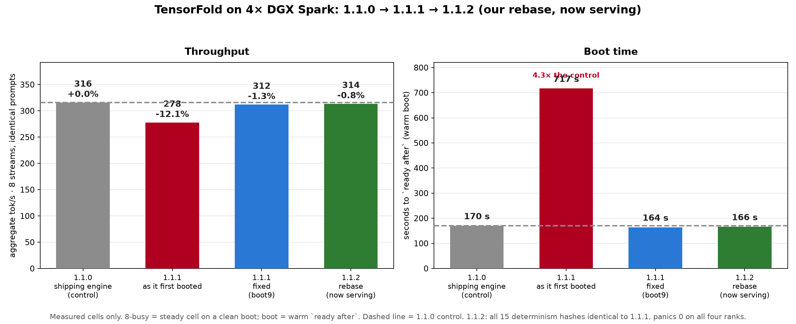

**The 717 s boot.** The 1.1.1 rebase, as first booted, hashed the pack's digest **three times** at boot and read
**717.8 GB** from disk to do it. After the fix the boot reads 86.5 GB (`rchar`) and is ready in 161 s. On 1.1.2 it
reads 86.55 GB and the digest record is accepted as is (0 built, 44 read). The lesson: when boot time jumps after a
rebase, check the bytes read before you profile anything; a boot that reads the pack several times shows up there
first.

**What upstream 1.1.2 changed for DeepSeek: nothing.** Not one of the 201 upstream commits from 1.1.1 to 1.1.2
touches the DeepSeek family (`git rev-list --count d1018b31..4ff78441 -- zig/src/families/deepseek_v41` = 0). The measured proof
matches: against 1.1.1 (fixed), prefill 32K −0.6 % and 8K −0.6 %; **all 15 determinism hashes identical**; a JSON
request returns 200 and parses; the picture check answers "Blue and red"; 0 panics on all four ranks; 0 `BadBlob`.
So 1.1.2 does **not** fix four-rank prefill. Our own world-4 fixes are still needed. The rebase needed one fix of its
own: upstream changed the generic text render to return `Rendered`, which our DeepSeek renderer did not, so the
CPU server tests did not compile until it did.

**Open findings (not fixed):**
- `TF_DSV41_TXN_KEEP_SKIP=1` changes the restored continuation at deep restore (hash `7891662f` vs `bcf55924` at
  `=0`). It is our flag, not the rebase's; the serving config ships `=0`.
- Cross-restart NVMe session restore never runs: nothing calls `Store.reconcile` / `disk.scan` at boot, so the disk
  tier does nothing in production unless `SESSION_RAM_MIB` / `SESSION_RESIDENT` are set. Inherited, not a
  regression.

<sub>8 / 4 streams busy = steady aggregate decode with every stream on an identical prompt, clean boot. Boot = start to
the engine's `ready after` line. Two or three samples where shown, otherwise one; use this table to compare engine
versions, not other rulers in this lane.</sub>

📈 [qbench chart vs the previous pack](results/dsv41-1017-20261017/qbench-dsv41-vs-1017.png) · 🧾 [Results and notes](results/dsv41-1017-20261017/README.md) ·
raw: [`qbench-dsv41-1017-zig-20261017.json`](results/dsv41-1017-20261017/qbench-dsv41-1017-zig-20261017.json)

🔁 **How to reproduce.** Serve the model with [tensorfold-4x-sparks' RUN.md](https://github.com/neko-legends/tensorfold-4x-sparks/blob/main/deploy/dsv41-1017/RUN.md), then, with `E=http://<rank0>:8000/v1` and `M=DeepSeek-V4.1-Flash-1017-TF`:
quality + speed `python3 bench/qbench.py --base-url $E --model $M --areas all --workers 4 --out q.json` (the Venice row: the same with the hosted endpoint, its model id, `--api-key` and `--venice`) ·
cold prefill `python3 bench/prefill-ladder.py $E $M prefill.json 32768,131072,200000` ·
vision `SPARK_VISION=<spark-vision checkout> python3 bench/window-vision.py $E $M vision.json a1_poster,a2_dashboard,a3_shapes,a4_table_chart,a5_big4096,k_f_counts` ·
harness rows `python3 bench/harness/run.py --harness pi|dsh|claude-shim --row B|C|D1 --base-url $E --model $M --out row.json`, table `bench/harness/table.py`.

<a id="dsv41-1017-harness"></a>

### 🧰 Harness effect: the same 1017 weights under four agent harnesses

111 tasks from the same bench (coding 5, GSM8K-30, a fixed 50-item MMLU subset, IF 20, JSON 6), each a fresh agent
session that writes its answer to a file, graded by qbench's own graders. Rows A–D1 use the same 1017 weights on the
Sparks. Row D2 is Claude Code with its own model, as a reference point.

| row | harness | version | model | coding | math | MMLU-50 | IF | JSON | total | wall | LLM calls | tool calls | engine tokens |
|---|---|---|---|---|---|---|---|---|---|---|---|---|---|
| A | raw API, no harness (qbench) | qbench v1 | 1017 | 4/5 | 30/30 | 43/50 | 18/20 | 6/6 | **101/111** | 85 s (incl. all 200 MMLU) | 1 per task | – | – |
| B | pi coding agent | 0.99.1 | 1017 | 4/5 | 30/30 | 41/50 | 20/20 | 6/6 | **101/111** | 264 s | 234 | 123 | prompt 406,146 (cached 205,792) / completion 14,012 |
| C | DeepSeek harness (dsh), sdk-minimal | dsh-v0.2.1-rc.2 (687f282e86) | 1017 | 4/5 | 30/30 | 41/50 | 20/20 | 6/6 | **101/111** | 214 s | 261 | 135 | prompt 231,650 (cached 130,688) / completion 12,293 |
| D1 | Claude Code + our Anthropic shim | 2.1.301 | 1017 | 4/5 | 30/30 | 39/50 | 18/20 | 6/6 | **97/111** | 1101 s | 762 | 652 | prompt 33,737,373 (cached 31,946,896) / completion 70,375 |
| D2 | Claude Code, native (reference) | 2.1.301 | Claude Opus | 4/5 | 30/30 | 46/50 | 20/20 | 6/6 | **106/111** | 166 s | – | 113 | (not on the Sparks) prompt 3,395,314 / completion 23,086, as Claude Code reports them |

- **The harness barely matters for this model:** the raw API, pi and DeepSeek's own harness all score **101/111**. Claude
  Code through our engine's Anthropic route scores **97**: two correct MMLU answers stayed in chat instead of the file, and
  one IF task looped 542 self-check turns into the timeout. It also used 4–5× the wall time and 80–150× the prompt tokens.
  Native Claude Code with Claude Opus scores **106**.
- ⚠️ **Sampling differs by harness.** qbench and pi send temperature 0. DeepSeek's harness and Claude Code send none, and
  the engine's default then behaves like temperature 1. Part of the C/D1 difference can be sampling. The control run with
  temperature forced to 0 was not done.
- Tools are not scored here (a harness brings its own tools), and JSON is an instruction, not `response_format`.

🧾 [Method, caveats and per-task results](results/dsv41-1017-20261017/harness/README.md)

<a id="3d-tests"></a>

### 🏗️ 3D tests: four models build a garage from one reference image

Each model ran as a coding agent with the same prompt file (sha256 `f88e8390…` voxel, `91540b15…` Blender), the same
reference image, starter, tools and caps. It saw the reference only through its own vision. **Voxel:** write the
garage as a three.js scene in code. **Blender:** build it by driving Blender over MCP. A neutral judge (GPT-6 Astra)
compared six zoomed regions of each build with the reference, in both presentation orders, and kept the lower score
(seed 20261016).

<picture>
  <source media="(prefers-color-scheme: dark)" srcset="docs/images/3d-scores-dark-20261017.png">
  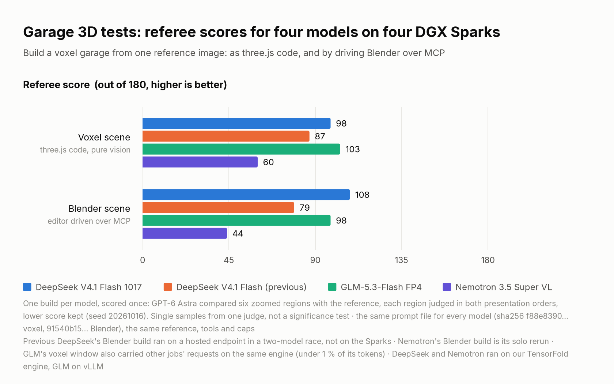
</picture>

<picture>
  <source media="(prefers-color-scheme: dark)" srcset="docs/images/3d-regions-dark-20261017.png">
  
</picture>

<picture>
  <source media="(prefers-color-scheme: dark)" srcset="docs/images/3d-renders-voxel-dark-20261017.png">
  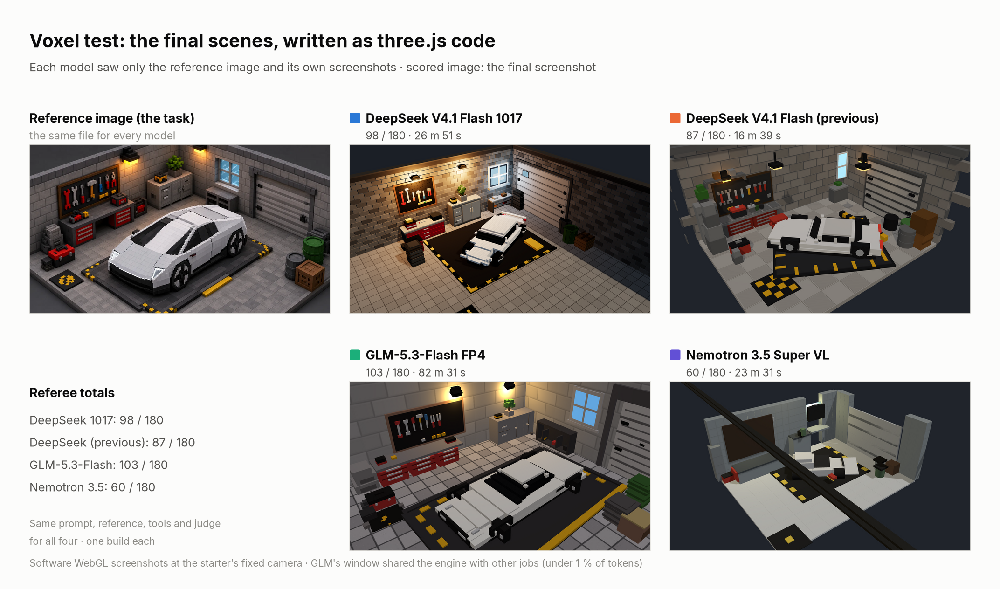
</picture>

<picture>
  <source media="(prefers-color-scheme: dark)" srcset="docs/images/3d-renders-blender-dark-20261017.png">
  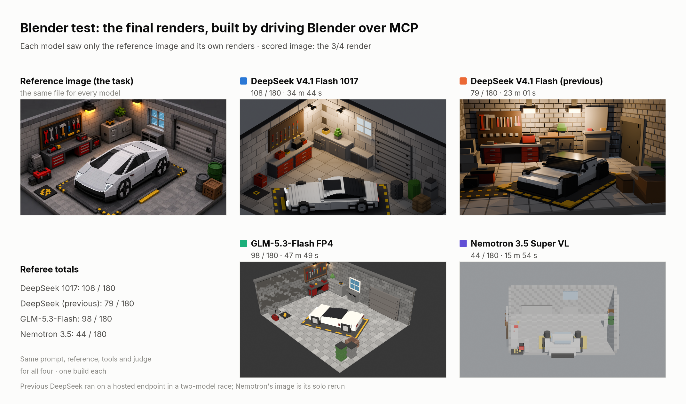
</picture>

<picture>
  <source media="(prefers-color-scheme: dark)" srcset="docs/images/3d-wall-time-dark-20261017.png">
  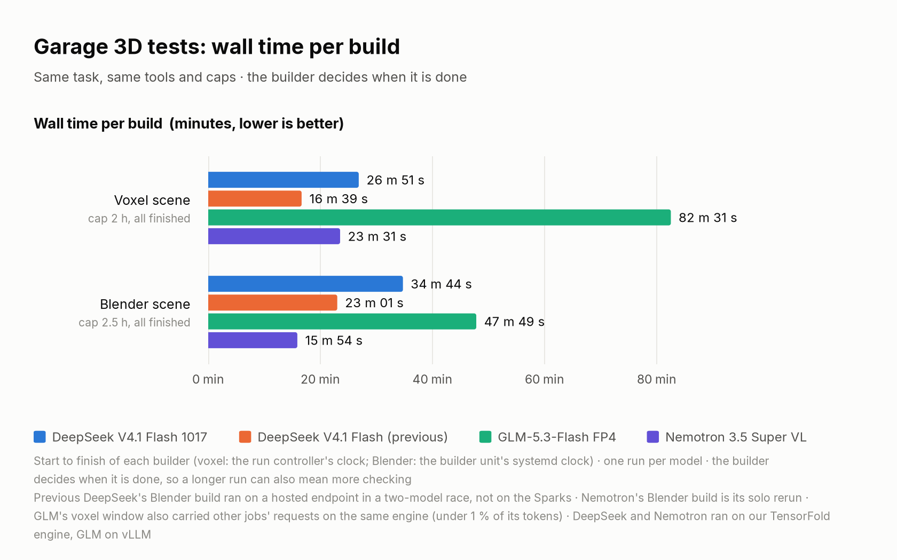
</picture>

- **Single samples:** one build per model per test, scored once by one judge. A gap of a few points is not significant.
- The previous DeepSeek's Blender build ran on a hosted endpoint in a two-model race, not on the Sparks. Nemotron's
  Blender build is its solo rerun. GLM's voxel window also carried other jobs' short requests on the same engine (under
  1 % of its tokens). 1017's and GLM's runs reconcile exactly against the engine's request counters otherwise.
- None of the four garages meets the "recreated" bar: the best region scores 24/30, and fine detail scores 1–2 everywhere.

---

<a id="glm53-fp4-vllm"></a>

## 🐉 GLM-5.3-Flash FP4 · vLLM · 🔵 compared 2026-10-17, not serving

`nvidia/GLM-5.3-Flash-FP4-Local` on vLLM (the community b12x image the model card requires), TP=4 across the four Sparks,
benched with the same harnesses on 2026-10-17. Two launch fixes were needed on our fabric (the RoCE GID index and a
thinking-off switch in the chat template); both are documented in the results page.

- **Quality is level with DeepSeek** on the frozen bench: MMLU-200 88.0 %, and equal elsewhere, except 4.2 % invented
  numbers in summaries. **3D:** top voxel score of the four (103/180) and second on Blender (98), single samples.
- **It is about half the speed:** code 82.0 / prose 36.5 tok/s for one stream, 81.2 for four; cold 200K-token prompt 79.4 s.
  Its 3D builds took 82.5 and 47.8 minutes.
- **Corrections from an independent review:** its long-context passkey prompts were never calibrated on this run
  (26.7K / 106.8K / 243.5K tokens, not the other rows' sizes; qbench now fails loudly instead), and the 3D scores are
  single samples from one judge.
- A port of GLM to our TensorFold engine is **work in progress** (not merged, not serving): same quality, slower decode
  so far. [Its bench page](results/glm53-fp4-tf-20261017/README.md) carries the review's corrections.

🧾 [Results, launcher and notes](results/glm53-fp4-vllm-20261017/README.md) · 📈 [qbench chart vs DeepSeek](results/glm53-fp4-vllm-20261017/qbench-dsv41-vs-glm53.png)

---

<a id="now-serving-20261016"></a>

## 📌 Previous note: back on DeepSeek V4.1 Flash, not Nemotron (2026-10-16)

The Sparks are back on **DeepSeek V4.1 Flash** (TensorFold Zig engine, TP=4) as of 2026-10-16. We moved off
**Nemotron 3.5 Super VL** after two real-world agent tests, despite Nemotron's promising speed numbers. Its speed
and serving figures below stay published and are accurate. The decision came down to the quality of the result.

**The deciding test.** Each model ran as a coding agent on our four Sparks, with the same prompt (byte-identical),
the same reference image, the same tools, and the same 2 h cap. The task: look at the reference and build the same
voxel-style 3D garage as a live three.js scene in code — no 3D editor, no modelling tools. Each builder checked its
own work by screenshotting its page and reading the screenshots through the vision harness of its own model.

| | DeepSeek V4.1 Flash | Nemotron 3.5 Super VL |
| --- | ---: | ---: |
| Referee total (6 zoomed regions × 30) | **87 / 180** | 60 / 180 |
| Regions won | **6 of 6** | 0 of 6 |
| Wall time | **16 m 39 s** | 23 m 31 s |
| Tool calls (errors) | 87 (1) | 60 (5) |

A neutral third model refereed: it compared six zoomed regions of each build with the reference, judged every pair
in both orders (blinded), and kept the lower score on disagreement. A model-free pixel check agrees with the referee
(histogram overlap with the reference 0.77 vs 0.56; empty-background share 23% vs 50%). DeepSeek's build matches the
reference's palette, layout and props: brick walls, the tool pegboard, red drawers, the cabinet with its plant, warm
lamps, the striped parking pad, barrels and the crate. Nemotron got the room layout but its scene carries a long
black bar across the view — a bug in its own code, four window-pane calls missing an argument, which turned a colour
value into a depth of roughly ten million units. It also went 23 minutes with five malformed edits and checked its
own work half as often (25 harness runs vs 51).

| Reference image (the task) | DeepSeek V4.1 Flash | Nemotron 3.5 Super VL |
| :-: | :-: | :-: |
|  | 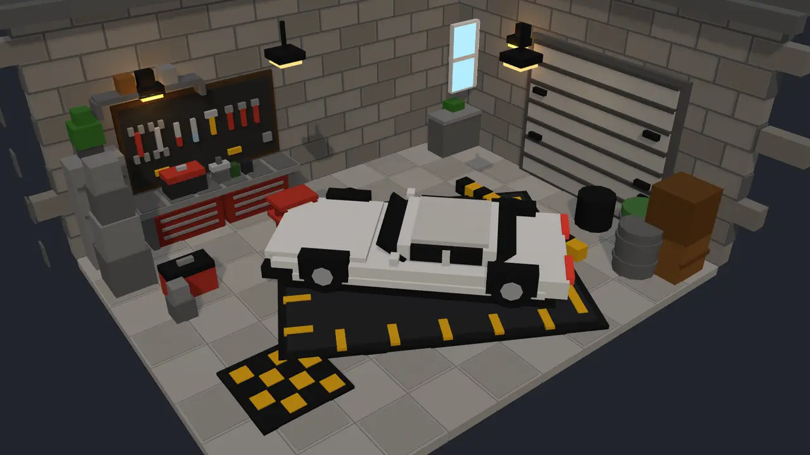 | 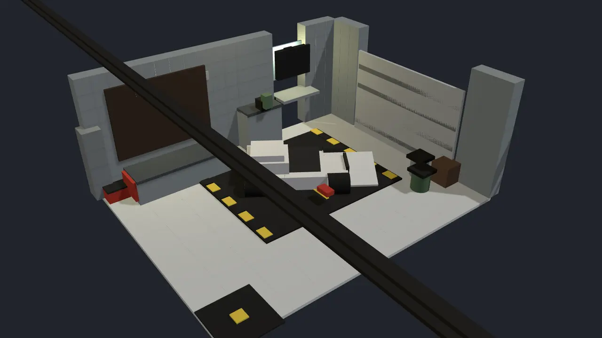 |

**Second test: driving a 3D editor through tool calls.** Same reference, same kind of agent, but this time each model
built the garage by controlling Blender over MCP, writing editor code through tool calls and checking renders with its
vision harness. Same referee setup: six zoomed regions, blinded, both orders, lower score kept.

| | DeepSeek V4.1 Flash | Nemotron 3.5 Super VL |
| --- | ---: | ---: |
| Referee total (6 zoomed regions × 30) | **79 / 180** | 44 / 180 |
| Regions won | **5 of 6** | 1 of 6 |

| Both Blender builds side by side, labelled with model, time and tokens |
| :-: |
| 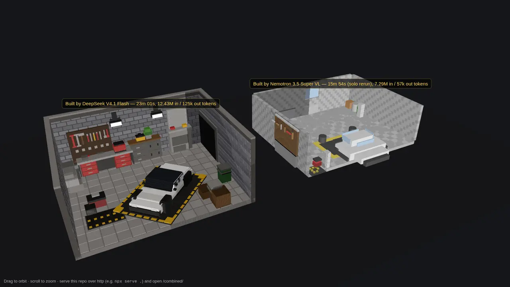 |

Both tests point the same way: DeepSeek V4.1 Flash turns a reference image into a faithful scene more reliably, whether
it writes the scene itself or drives an editor to build it.

---

<a id="nemotron-tensorfold"></a>

## 🟩 Nemotron 3.5 Super VL · TensorFold (Zig engine) · 🟡 previous (live 2026-10-15 → 2026-10-16)

> 📌 **Not serving since 2026-10-16.** We went back to DeepSeek V4.1 Flash after a real-world agent test: building a
> 3D garage from one reference image, a blinded referee scored DeepSeek 79/180 and Nemotron 44/180
> ([details and images](#now-serving-20261016)). The numbers below are still accurate. The reason is result quality, not speed.

NVIDIA's [Nemotron 3.5 Super VL 120B-A12B](https://huggingface.co/nvidia/NVIDIA-Nemotron-3.5-Super-VL-120B-A12B-NVFP4)
(NVFP4 as shipped: 40 Mamba-2, 40 latent-MoE and 8 attention blocks, 12B active, MTP draft head, vision encoder) on
TensorFold's Zig engine, our TP-4 port over RoCE. Same suites as the DeepSeek lane below, side by side.

<picture>
  <source media="(prefers-color-scheme: dark)" srcset="docs/images/nemotron-vs-deepseek-speed-dark.svg">
  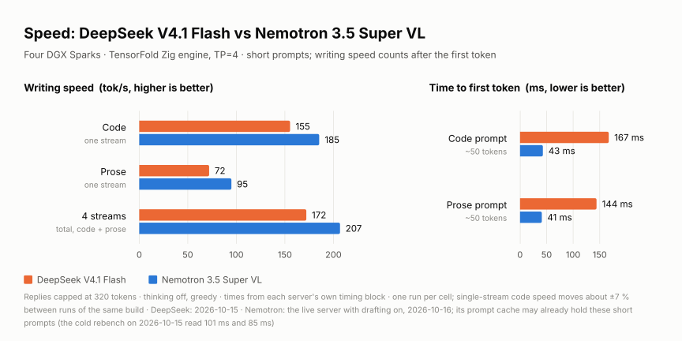
</picture>

**Serving capacity (measured on the live server, 2026-10-15/16):**

- 🧵 **16 conversations at once**, each with a **307,200-token** window.
- 🚀 **214–230 tok/s** total with all 16 streams busy; first token with 16 arriving together **0.8 s median, 1.9 s worst**.
- ✍️ One stream: **185 tok/s** code, **95** prose, first token **43 ms** (MTP drafts sized by confidence: code 165 → 183, same text).
- 🧠 **40 GiB prompt cache in memory on every rank + a disk tier:** 200 agents returning to a 10K-token history wait
  **0.09 s** (200/200 hits); after a restart 8 × 30K-token conversations resume in **0.33 s** instead of 6.0 s.
- 🖼️ Images: **~70 a minute** for images the server has seen (1.3 s first token at 16 at once), **~23 a minute** for
  new ones (each new image is prepared one at a time, so 16 new images at once wait 25 s median). Accuracy is the
  same under load: 98.9 % of text strings with 16 tiled reads at once vs 98.6 % on one stream.

| Area | Result | DeepSeek V4.1 Flash, same suite |
| --- | ---: | ---: |
| Knowledge, MMLU-200 | **85.0 %** (170/200) | 88.5 % |
| Math, GSM8K 0–29 | **96.7 %** (29/30) | 100 % |
| Coding, 5 tasks | **80 %** (4/5) | 80 % |
| Instruction following | **95 %** (19/20) | 90 % |
| JSON schema · tools · long context (25K/100K/229K-token prompts) · summary facts | **100 %** · **100 %** · **100 %** · **100 %** | 100 % · 100 % · 100 % · 100 % |
| Vision: text read exactly (166 strings) | **100 %** | 100 % |
| Vision: shapes (30) · objects counted (23) | **87 %** · **4 %** | 87 % · 96 % |
| Cold 200K-token prompt | **48.3 s** | 36.8 s |

Nemotron writes faster and holds 16 long conversations; DeepSeek is ahead on MMLU and math, reads a cold long prompt
faster and counts objects in images far better. The shapes figure is with the served `NCCL_MAX_NCHANNELS=2` (faster
long prompts): the shapes scene read 17/20 with it and 19/20 without.

<picture>
  <source media="(prefers-color-scheme: dark)" srcset="docs/images/nemotron-memory-dark.svg">
  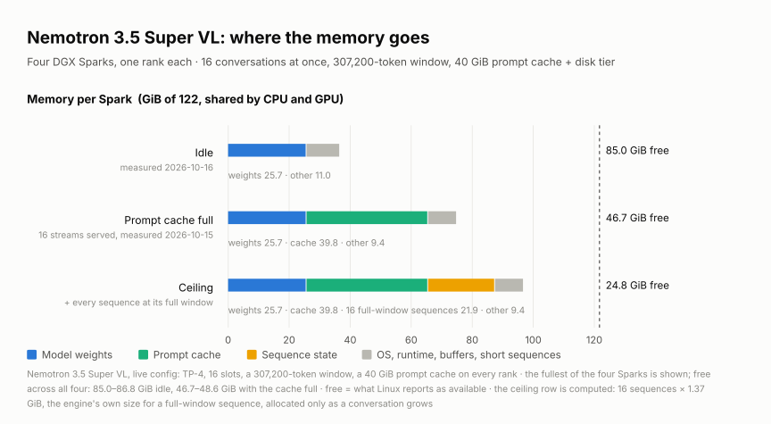
</picture>

<picture>
  <source media="(prefers-color-scheme: dark)" srcset="docs/images/nemotron-vision-serving-dark.svg">
  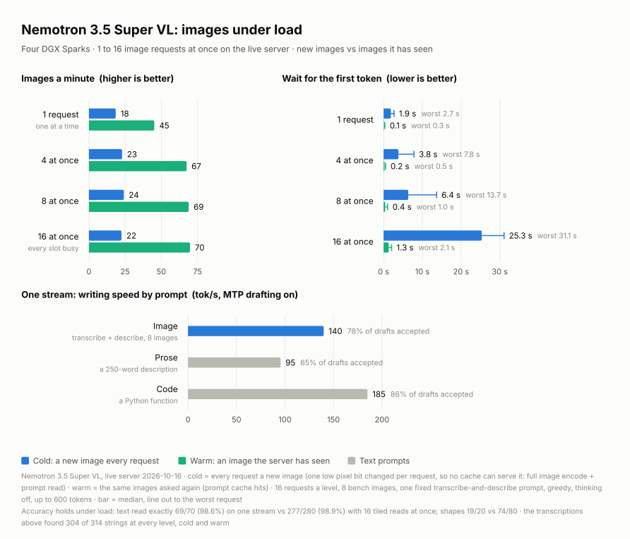
</picture>

<details>
<summary>More charts: quality, cold prompts, vision accuracy, serving under load, drafting</summary>

<picture>
  <source media="(prefers-color-scheme: dark)" srcset="docs/images/nemotron-vs-deepseek-quality-dark.svg">
  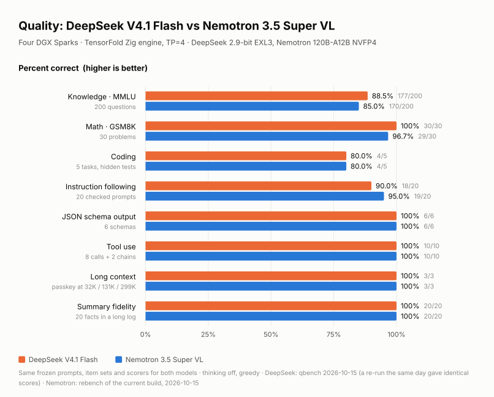
</picture>

<picture>
  <source media="(prefers-color-scheme: dark)" srcset="docs/images/nemotron-vs-deepseek-prefill-dark.svg">
  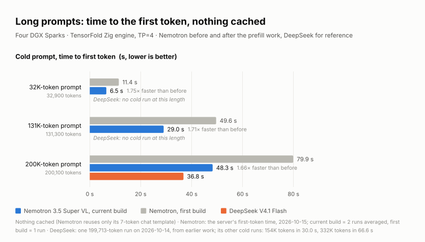
</picture>

<picture>
  <source media="(prefers-color-scheme: dark)" srcset="docs/images/nemotron-vs-deepseek-vision-dark.svg">
  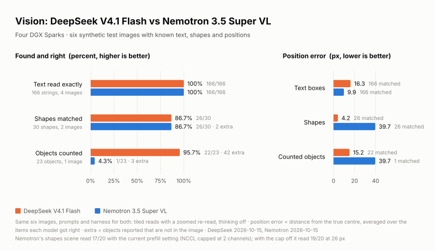
</picture>

<picture>
  <source media="(prefers-color-scheme: dark)" srcset="docs/images/nemotron-serving-dark.svg">
  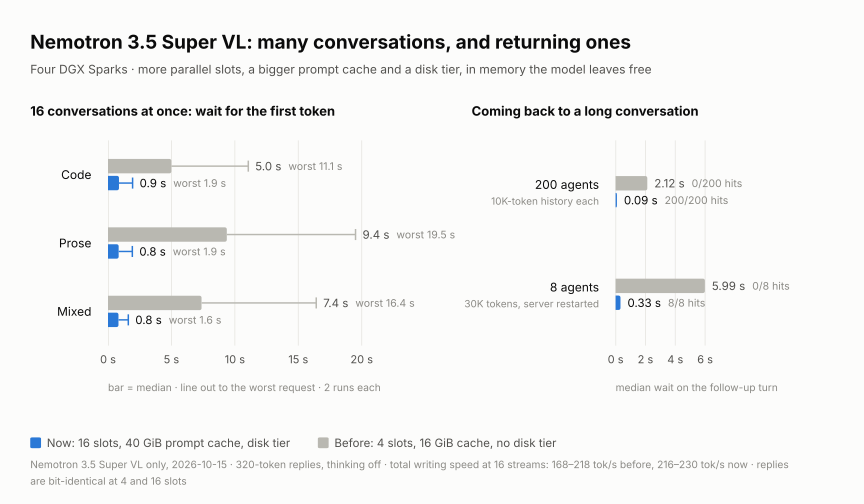
</picture>

<picture>
  <source media="(prefers-color-scheme: dark)" srcset="docs/images/nemotron-drafting-dark.svg">
  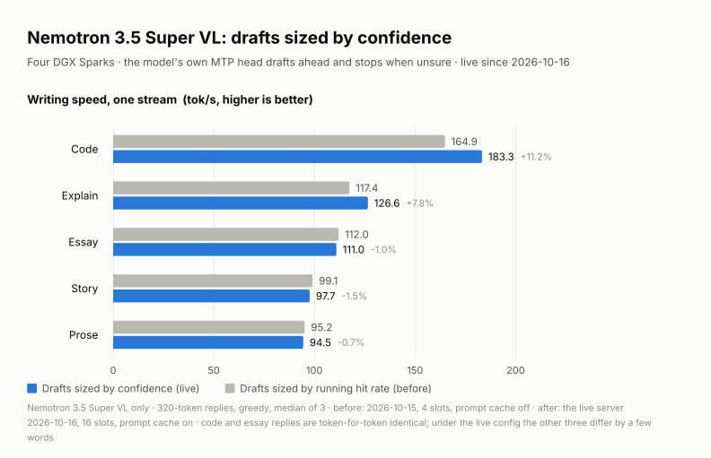
</picture>

</details>

📦 [Recipe, engine and how to run: tensorfold-4x-sparks](https://github.com/neko-legends/tensorfold-4x-sparks#nemotron-35-super-vl-120b-a12b-nvfp4) · 🗂️ [Result files](results/nemotron-supervl-tensorfold-20261016/README.md) · 🖼️ [Vision under load](results/nemotron-supervl-tensorfold-20261016/vision-serving/README.md) · 🧾 [Port log](https://github.com/neko-legends/tensorfold-4x-sparks/blob/main/engine/zig-nemotron/NEMOTRON-PORT-LOG.md)

---

<a id="dsv41-tensorfold"></a>

## 🐋 DeepSeek V4.1 Flash · TensorFold (Zig engine) · 🟡 previous (live 2026-10-11 → 2026-10-15 and 2026-10-16 → 2026-10-17)

> 📌 **Replaced by [DeepSeek V4.1 Flash 1017](#dsv41-1017) on 2026-10-17**, on the same engine and settings. This lane
> served the uncensored V4.1 2.9-bit pack. Its numbers below stay accurate.

<picture>
  <source media="(prefers-color-scheme: dark)" srcset="docs/images/lane-dsv41-tensorfold-dark.svg">
  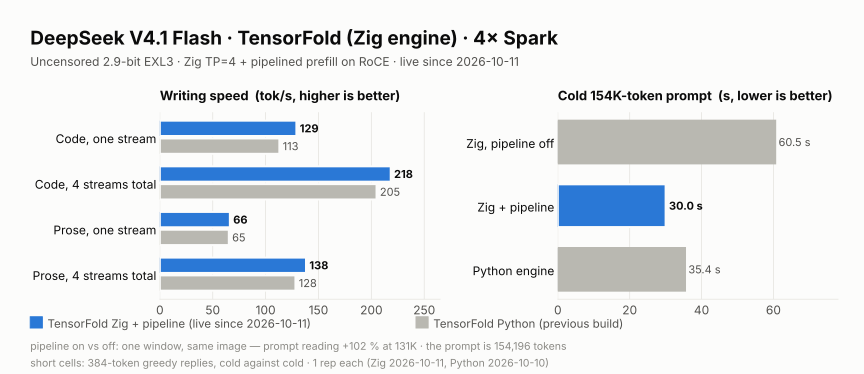
</picture>

<a id="dsv41-baseline"></a>

### 📊 Quality + speed baseline (2026-10-15)

One frozen suite (`bench/qbench.py`) against the TensorFold Zig engine while it was live (TP=4 over RoCE), thinking off, greedy decoding, 283 requests, 0 transport errors. Scores are plain percentages on fixed inputs.

| Area | What was asked | Result |
| --- | --- | ---: |
| Knowledge | MMLU-200, 0-shot, single A–D letter | **88.5 %** (177/200) |
| Math | GSM8K test items 0–29, exact final number | **100 %** (30/30) |
| Coding | 5 tasks, hidden stdlib-unittest tests | **80 %** (4/5) |
| Instruction following | 20 items, programmatic checkers | **90 %** (18/20) |
| Structured output | 6 JSON-Schema tasks, validated client-side | **100 %** (6/6) |
| Tool use | 8 single calls + 2 dependent chains | **100 %** (10/10) |
| Long context | passkey at 25K / 100K / 229K tokens | **100 %** (3/3) |
| Summarization | 20-fact log → summary: facts kept / stale returned / invented numbers | **100 %** / **0 %** / **0 %** |
| Vision: text | code-rendered images read in tiles, strings matched exactly | **98.5 %** (259/263; 7 of 8 text images at 100 %) |
| Vision: counts, shapes, colour | region counts · shape matching · measured hex | counts **100 %** exact (39/39, 23/23, 11/11) · shapes **100 %** (20/20) · flat-fill colour ΔE 0.0 |

| Speed (320-token outputs) | Decode tok/s | First token |
| --- | ---: | ---: |
| Code, 1 stream | **153.8** | 0.17 s |
| Prose, 1 stream | **70.2** | 0.15 s |
| 4 streams, aggregate | **170.2** | 0.17–0.50 s |

📈 [Chart](results/qbench-dsv41-only-20261015.png) · 🔁 To reproduce, see [RERUN.md](RERUN.md) and [results/](results/) (raw per-item records: [`qbench-dsv41-zig-20261015.json`](results/qbench-dsv41-zig-20261015.json)). The vision rows come from a separate image harness, not `qbench.py`.

---


- 🟢 **The serving engine is Zig** (live 2026-10-11 → 2026-10-15 and 2026-10-16 → 2026-10-17, TP=4 over RoCE with pipelined prompt reading): code **129** tok/s for one stream, **218** for four; prose **66** / **138**. [Report](artifacts/tensorfold-v41-zig-20261011/REPORT.md).
- 🏭 **Pipelined prompt reading is the big lever:** +75 % at 32K and **+102 % at 131K** prompt tok/s against the same build with it off (one window, controlled); the cold 154K-token prompt's first token halves, 60.5 → **30.0 s**. Decode unchanged (±1 %).
- 🧪 **Long context, cold, measured 2026-10-14** — past the 131K the pipeline figure above tops out at: a **199,713-token** prompt returned its first token at **36.8 s** (~5,400 prompt tok/s), and a **332,847-token** prompt (79 % of the 420,096-token request slot) at **66.6 s** (~5,100 prompt tok/s). Both requests report `cached_tokens: 0`, so both reads are genuinely cold rather than prefix-cache hits. Thinking off for the clean timing run.

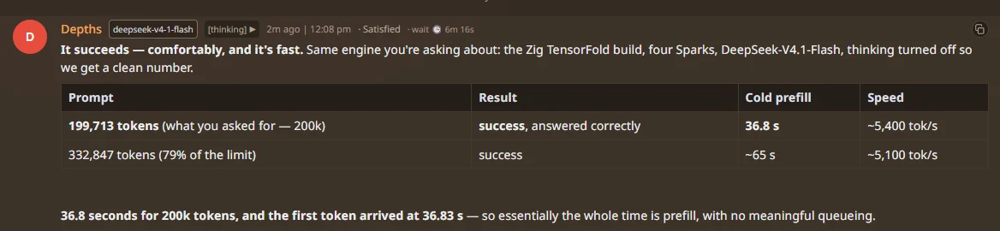

- ⚖️ **Against the previous Python engine** (cross-session, RoCE, cold against cold): code +14 % (×1) / +7 % (×4), prose +2 % (×1) / +8 % (×4), first token −15 %.
- 📜 The Python engine's numbers stay in the [lane page](models/deepseek-v4.1-flash/tensorfold-4x/README.md) and [journal](models/deepseek-v4.1-flash/JOURNAL.md) (G19 on RoCE, live 2026-10-07 → 2026-10-11: 420K context, image input, prose 66.5 / code 104.1 tok/s over 1k–160k, cold 160k prompt 36 s); the 1k–160k depth sweep and `m2bench` steady runs have no Zig equivalent yet, so those rows end with the Python engine.
- 🛠️ History: the bugs from Jay's review are fixed; a stale failure file once silently forced NCCL for two days (12–19 %). [Reports](artifacts/).

📦 [Recipe: tensorfold-4x-sparks](https://github.com/neko-legends/tensorfold-4x-sparks#deepseek-v41-flash) · 📘 [Setup & limits](models/deepseek-v4.1-flash/tensorfold-4x/README.md) · 📓 [Journal](models/deepseek-v4.1-flash/JOURNAL.md) · 🧾 Reports: [Zig benchmark](artifacts/tensorfold-v41-zig-20261011/REPORT.md), [decode](artifacts/tensorfold-v41-roce-20261007/REPORT.md), [prompt reading](artifacts/tensorfold-v41-prefill-20261005/REPORT.md), [fixes](artifacts/tensorfold-v41-fixes-20261005/REPORT.md)

<a id="dsv41-sglang"></a>

## 🐋 DeepSeek V4.1 Flash · SGLang · 🟡 rollback

<picture>
  <source media="(prefers-color-scheme: dark)" srcset="docs/images/lane-dsv41-sglang-dark.svg">
  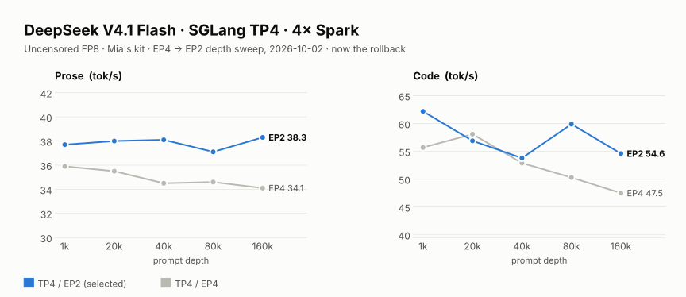
</picture>

- 🧪 **Uncensored FP8** on [Mia's kit](https://github.com/MiaAI-Lab/DeepSeek-v4.1-Flash-DGX-Sparks), DSpark k=3, **1M context** (needle-checked).
- 🔀 **EP2 beat EP4**: prose +5–12%; code mixed, up to +19% at 80k–160k.
- 📦 **Engram pack published**, so you can skip the slow per-node pack step: [Hugging Face](https://huggingface.co/neko-legends/DeepSeek-V4.1-Flash-uncensored-engram-4x-spark).

📘 [Profile & rollback](models/deepseek-v4.1-flash/README.md) · 📓 [Journal: the fixes it took](models/deepseek-v4.1-flash/JOURNAL.md#dsv41-sglang-2026-09-14) · 🧾 [Depth sweep](artifacts/tensorfold-v41-depth-20261001/REPORT.md)

<a id="deepseek-v4-1-flash"></a>

## 🐋 DeepSeek V4.1 Flash · vLLM · 🟡 fallback

<picture>
  <source media="(prefers-color-scheme: dark)" srcset="docs/images/lane-dsv41-vllm-dark.svg">
  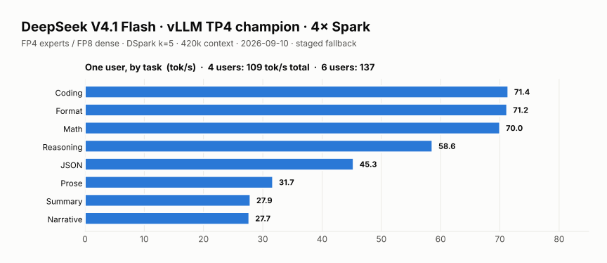
</picture>

- 💾 **A 510 GB model on four Sparks:** each rank reads its quarter of the Engram tables from NVMe.
- 🎲 **The "gains" were the boot lottery:** A/B/A showed the champion settings matched the baseline.
- 🧯 **Tool calls came back clean here** where our first SGLang lane corrupted them. That is why this lane shipped.

📘 [Recipe & findings](docs/dsv41-vllm-tp4.md) · 📓 [Journal](models/deepseek-v4.1-flash/JOURNAL.md#deepseek-v4-1-flash) · 🧾 [Raw runs](artifacts/dsv41-vllm-20260910/)

<a id="qwen-3-8-flash"></a>

## 🦄 Qwen 3.8 Flash Next · ⚪ archived

<picture>
  <source media="(prefers-color-scheme: dark)" srcset="docs/images/lane-qwen38-dark.svg">
  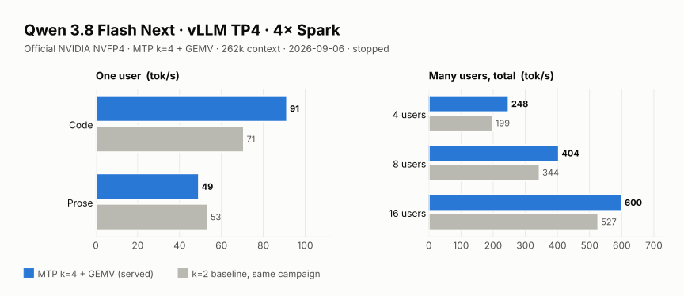
</picture>

- 🚀 **MTP k=4 + a GEMV kernel:** +29% code for one user, +14% total at 16 users. Prose −8%, the trade-off.
- 🤝 **Real agent tasks:** quality matched or beat the cloud on all five; up to 29× faster on four of them.
- 📦 Official NVIDIA NVFP4, TP4+EP, 262k context.

📘 [Recipe](models/qwen-3.8-flash-next/README.md) · 📓 [Journal](models/qwen-3.8-flash-next/JOURNAL.md) · 🧾 [Campaign report](results/qwen38-tuning-2026-09-06/REPORT.md)

<a id="glm-5-3-flash"></a>

## 🐉 GLM 5.3 Flash · ⚪ archived

<picture>
  <source media="(prefers-color-scheme: dark)" srcset="docs/images/lane-glm53-dark.svg">
  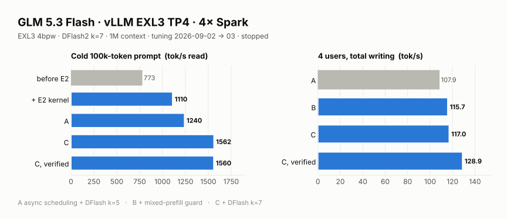
</picture>

- 📚 **Long prompts read 2× faster** with MiaAI's E2 fat-expert kernel (300k-token prompt in ~4 min).
- 🔓 **Our own uncensored EXL3 quant**, published: [Hugging Face](https://huggingface.co/neko-legends/GLM-5.3-Flash-Uncensored-EXL3).
- 🧯 **The 0.85 memory setting crashed it after 13 hours;** use 0.80.

📘 [Recipe](models/glm-5.3-flash/README.md) · 📓 [Journal](models/glm-5.3-flash/JOURNAL.md) · 🧾 [Verified runs](results/)

<a id="deepseek-v4-flash"></a>

## 🐳 DeepSeek V4 Flash · ⚪ archived

<picture>
  <source media="(prefers-color-scheme: dark)" srcset="docs/images/lane-dsv4-dark.svg">
  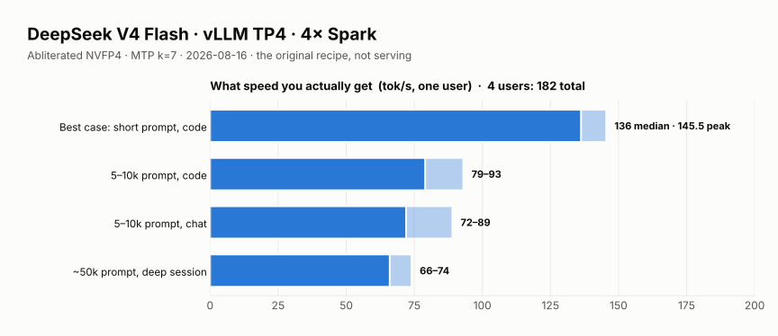
</picture>

- 🏆 **The fastest single-user decode we have measured here:** 136 tok/s median, 145.5 peak.
- 🗺️ **Real chat speed is lower** (66–93 tok/s), depending on prompt length and how predictable the text is.
- 🔌 **This lane taught us the one-IPv4 rule:** removing a leftover address took decode from 103 to 136 tok/s.

📘 [Recipe](models/deepseek-v4-flash/README.md) · 📓 [Journal](models/deepseek-v4-flash/JOURNAL.md) · 🧾 [Raw runs](results/)

---

## 🧰 Also here

- 📏 **[RERUN.md](RERUN.md)**: one model-agnostic runner (`bench/qbench.py`, endpoint + model id as args), the frozen inputs behind it, what is already benched, and the exact command to point the whole suite at a new engine/model for a like-for-like chart. DeepSeek baseline per area: [results/BASELINE-dsv41-sparks-20261015.md](results/BASELINE-dsv41-sparks-20261015.md).
- 🔌 **[Fabric runbook](docs/FABRIC.md)**: CX-7, RoCE, the switch. Most "TP4 is slow" reports are network problems, not the model.
- 🔥 **[Catch-up sidecar](docs/CATCHUP.md)**: keeps a long chat warm in the local model's cache while you talk to another model.

<details>
<summary><b>📖 Glossary</b></summary>

| Term | Plain meaning |
|---|---|
| token | A chunk of a word (~¾ of one). The unit models read and write. |
| prefill ("reading") | The model reading your whole message before it can answer. |
| decode ("writing") | The model writing its answer. The speed you feel. |
| TP=4 | Four machines each hold ¼ of the model and confer on every token. |
| EP | Expert parallel: the MoE experts are spread across ranks. |
| KV / prefix cache | The model's short-term memory of your conversation. |
| speculative decoding (MTP / DFlash2 / DSpark) | Draft several tokens ahead, keep the good ones. Fast on code, slower on prose. |
| C1 / C4 | One stream / four at once. C4 is total throughput, not per-user speed. |
| RoCE / fabric | The 200G cables and switch between the Sparks. |

</details>

<details>
<summary><b>🗂️ Layout</b></summary>

```text
models/<model>/              recipe (README.md) + dated history (JOURNAL.md) per model
models/README.md             lane index + rules for operators and agents
artifacts/  results/         raw, dated evidence behind every number
docs/FABRIC.md               CX-7 / RoCE / switch runbook (read before benching)
docs/CATCHUP.md              catch-up sidecar · docs/PROTOCOL.md · docs/BRIDGES.md
docs/images/                 one chart per lane (light + dark SVG)
scripts/                     launchers, bench harnesses, recovery, charts/
catchup/                     the sidecar (stdlib only)
docker-compose.dspark-tp4.yml, patches/, vllm_patch_gb10/   DeepSeek V4 serving stack
```

</details>

<p align="center"><sub>A <b>Neko Legends</b> project 🐾 · formerly <code>dspark-kv-prefill-catchup</code></sub></p>
